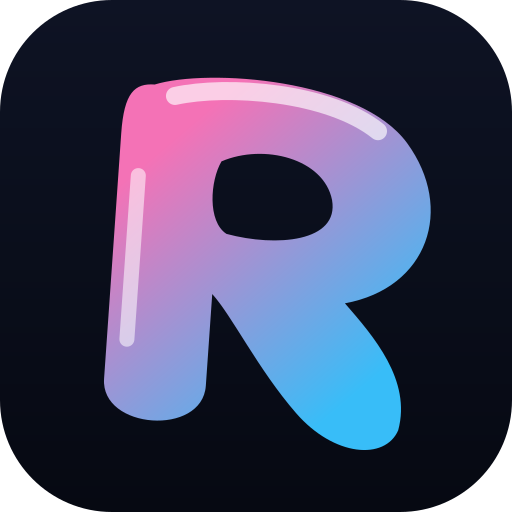
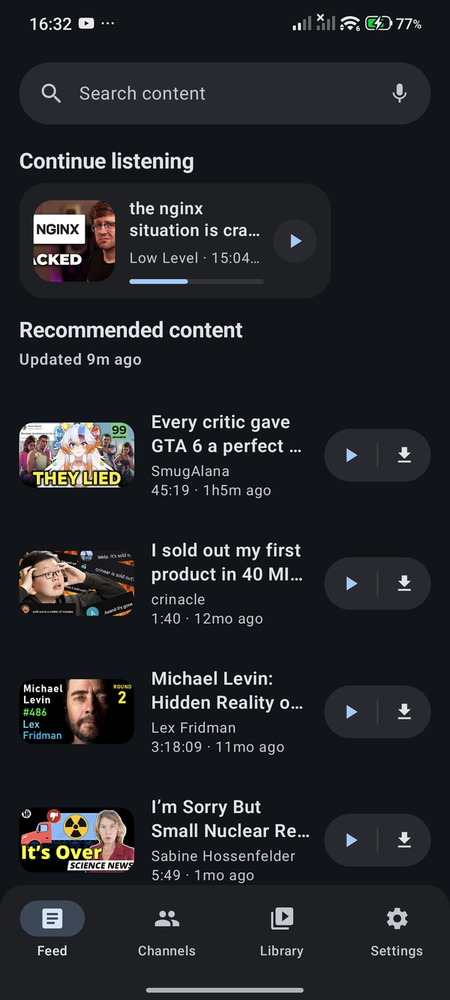
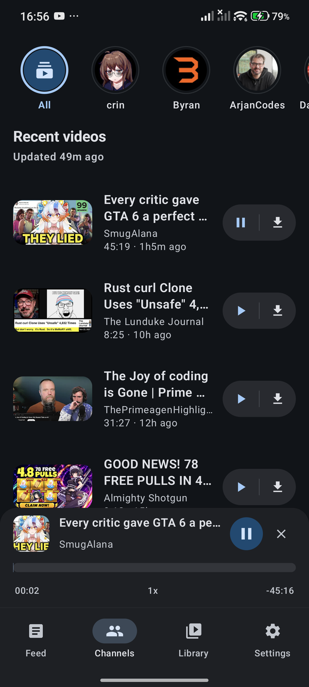
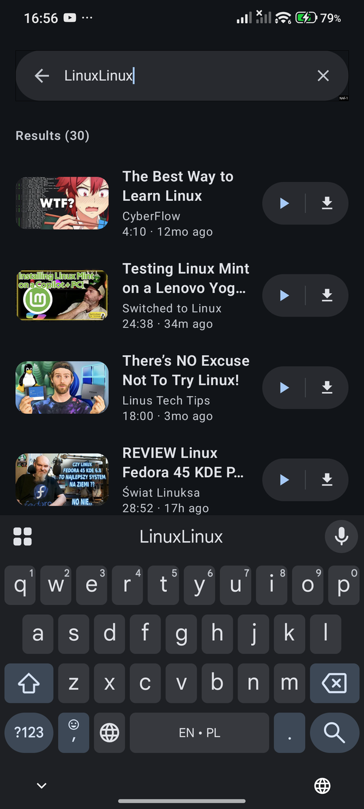

<div align="center">
  
  <h1>Reson</h1>
  <p>A lightweight, distraction-free Android audio player for YouTube content.</p>
</div>

Reson lets you follow your favorite YouTube channels, stream audio in the background, and save episodes for offline listening without algorithmic feeds, comments, or Shorts cluttering your experience.

## Screenshots

| Feed | Channels | Now Playing | Search |
| :---: | :---: | :---: | :---: |
|  |  |  |  |

## Features

- **Background audio playback**: Keep listening while multitasking or with your screen turned off, with lock screen and notification media controls.
- **Creator-focused feed**: Follow channels you care about and see their latest uploads in chronological order.
- **No Shorts**: Videos in vertical aspect ratios (Shorts) are automatically filtered out.
- **Channel filtering**: Carousel at the top lets you filter recent uploads by a specific creator or browse all channels together.
- **Search & direct links**: Search for creators and videos directly, or paste a link to play or download.
- **Offline downloads**: Save audio tracks locally to listen when traveling or offline.
- **Local-first & private**: No account or login required. All history, followed channels, and downloads stay in a local SQLite database on your device with full export/import options in Settings.

## Tech Stack

- **UI**: Jetpack Compose with Material 3
- **Audio Engine**: AndroidX Media3 (ExoPlayer) + MediaSessionService
- **Extraction**: Embedded yt-dlp binary with Python runtime
- **Storage**: SQLite
- **Architecture**: 64-bit ARM (`arm64-v8a`)
- **Minimum Android version**: Android 16 (API level 36)

## Building from Source

Clone the repository and build using Gradle:

```bash
# Build debug APK
./gradlew assembleDebug

# Build release APK
./gradlew assembleRelease
```

The APK will be generated under `app/build/outputs/apk/`.
